# VERSA-COLLECTION

Galeria digital editorial para clientes com foco em experiência fotográfica imersiva, responsividade extrema, segurança de acesso e alta resolução.

```mermaid
%% Generated by [https://gitdiagram.com/versavisual-vinicius/versa-collection](https://gitdiagram.com/versavisual-vinicius/versa-collection)
flowchart TD

subgraph group_collection["Collection and access"]
  node_app["URL collection routing<br/>[App.tsx]"]
  node_page["Gallery orchestration<br/>[GalleryPage.tsx]"]
  node_registry["Collection registry"]
  node_settings[("Access settings and export log")]
  node_gate["Password and email gate"]
end

subgraph group_presentation["Gallery experience"]
  node_hero["Editorial collection cover<br/>[GalleryHero.tsx]"]
  node_header["Gallery header"]
  node_progressive["Progressive photo loading"]
  node_layout["Deterministic masonry layout"]
  node_grid["Infinite photo grid"]
  node_lightbox["Lightbox and slideshow<br/>[PhotoLightbox.tsx]"]
  node_slideshow["Slideshow timer"]
end

subgraph group_engagement["Visitor actions"]
  node_favorites[("Favorite persistence<br/>[useFavorites.ts]")]
  node_favorite_dialog["Favorites export dialog"]
  node_share["Photo sharing dialog<br/>[ShareDialog.tsx]"]
  node_download_dialog["Download request dialog<br/>[DownloadDialog.tsx]"]
  node_drive["Google Drive delivery"]
end

subgraph group_operations["Photographer operations"]
  node_admin["Photographer admin panel<br/>[AdminPanel.tsx]"]
  node_telemetry[("Anonymous telemetry<br/>[telemetry.ts]")]
end

node_visitor(("Gallery visitor"))
node_photographer(("Photographer"))
node_visitor_storage[("Browser storage")]

node_visitor -->|"opens collection"| node_app
node_app -->|"routes to"| node_page
node_page -->|"resolves collection"| node_registry
node_registry -->|"applies overrides"| node_settings
node_page -.->|"checks access"| node_gate
node_page -->|"renders"| node_hero
node_page -->|"renders"| node_header
node_page -->|"loads photos"| node_progressive
node_progressive -.->|"pages collection"| node_registry
node_progressive -.->|"provides photos for"| node_layout
node_grid -->|"calculates positions"| node_layout
node_page -->|"renders"| node_grid
node_page -->|"opens selected photo"| node_lightbox
node_lightbox -->|"controls"| node_slideshow
node_page -->|"tracks selections"| node_favorites
node_page -->|"renders"| node_favorite_dialog
node_page -->|"renders"| node_share
node_page -->|"renders"| node_download_dialog
node_download_dialog -->|"records export request"| node_settings
node_download_dialog -.->|"delivers files"| node_drive
node_photographer -->|"manages gallery"| node_admin
node_admin -->|"selects collection"| node_registry
node_admin -->|"saves settings and reviews exports"| node_settings
node_favorites -->|"persists favorites"| node_visitor_storage
node_settings -.->|"persists browser settings"| node_visitor_storage
node_favorites -->|"gets visitor identifier"| node_telemetry

click node_app "[https://github.com/versavisual-vinicius/versa-collection/blob/main/src/App.tsx](https://github.com/versavisual-vinicius/versa-collection/blob/main/src/App.tsx)"
click node_page "[https://github.com/versavisual-vinicius/versa-collection/blob/main/src/components/GalleryPage.tsx](https://github.com/versavisual-vinicius/versa-collection/blob/main/src/components/GalleryPage.tsx)"
click node_registry "[https://github.com/versavisual-vinicius/versa-collection/blob/main/src/data/collectionsRegistry.ts](https://github.com/versavisual-vinicius/versa-collection/blob/main/src/data/collectionsRegistry.ts)"
click node_settings "[https://github.com/versavisual-vinicius/versa-collection/blob/main/src/lib/collectionSettings.ts](https://github.com/versavisual-vinicius/versa-collection/blob/main/src/lib/collectionSettings.ts)"
click node_gate "[https://github.com/versavisual-vinicius/versa-collection/tree/main/src/components/Security](https://github.com/versavisual-vinicius/versa-collection/tree/main/src/components/Security)"
click node_hero "[https://github.com/versavisual-vinicius/versa-collection/blob/main/src/components/GalleryHero/GalleryHero.tsx](https://github.com/versavisual-vinicius/versa-collection/blob/main/src/components/GalleryHero/GalleryHero.tsx)"
click node_header "[https://github.com/versavisual-vinicius/versa-collection/blob/main/src/components/Header/AutoHideGalleryHeader.tsx](https://github.com/versavisual-vinicius/versa-collection/blob/main/src/components/Header/AutoHideGalleryHeader.tsx)"
click node_progressive "[https://github.com/versavisual-vinicius/versa-collection/blob/main/src/components/Masonry/useGalleryProgressivePhotos.ts](https://github.com/versavisual-vinicius/versa-collection/blob/main/src/components/Masonry/useGalleryProgressivePhotos.ts)"
click node_layout "[https://github.com/versavisual-vinicius/versa-collection/blob/main/src/components/Masonry/useMasonryLayout.ts](https://github.com/versavisual-vinicius/versa-collection/blob/main/src/components/Masonry/useMasonryLayout.ts)"
click node_grid "[https://github.com/versavisual-vinicius/versa-collection/blob/main/src/components/Masonry/InfiniteMasonryGrid.tsx](https://github.com/versavisual-vinicius/versa-collection/blob/main/src/components/Masonry/InfiniteMasonryGrid.tsx)"
click node_lightbox "[https://github.com/versavisual-vinicius/versa-collection/blob/main/src/components/Lightbox/PhotoLightbox.tsx](https://github.com/versavisual-vinicius/versa-collection/blob/main/src/components/Lightbox/PhotoLightbox.tsx)"
click node_slideshow "[https://github.com/versavisual-vinicius/versa-collection/blob/main/src/components/Lightbox/SlideshowController.tsx](https://github.com/versavisual-vinicius/versa-collection/blob/main/src/components/Lightbox/SlideshowController.tsx)"
click node_favorites "[https://github.com/versavisual-vinicius/versa-collection/blob/main/src/lib/useFavorites.ts](https://github.com/versavisual-vinicius/versa-collection/blob/main/src/lib/useFavorites.ts)"
click node_favorite_dialog "[https://github.com/versavisual-vinicius/versa-collection/blob/main/src/components/Dialogs/FavoritesDialog.tsx](https://github.com/versavisual-vinicius/versa-collection/blob/main/src/components/Dialogs/FavoritesDialog.tsx)"
click node_share "[https://github.com/versavisual-vinicius/versa-collection/blob/main/src/components/Dialogs/ShareDialog.tsx](https://github.com/versavisual-vinicius/versa-collection/blob/main/src/components/Dialogs/ShareDialog.tsx)"
click node_download_dialog "[https://github.com/versavisual-vinicius/versa-collection/blob/main/src/components/Dialogs/DownloadDialog.tsx](https://github.com/versavisual-vinicius/versa-collection/blob/main/src/components/Dialogs/DownloadDialog.tsx)"
click node_admin "[https://github.com/versavisual-vinicius/versa-collection/blob/main/src/components/Admin/AdminPanel.tsx](https://github.com/versavisual-vinicius/versa-collection/blob/main/src/components/Admin/AdminPanel.tsx)"
click node_telemetry "[https://github.com/versavisual-vinicius/versa-collection/blob/main/src/lib/telemetry.ts](https://github.com/versavisual-vinicius/versa-collection/blob/main/src/lib/telemetry.ts)"

classDef toneNeutral fill:#f8fafc,stroke:#334155,stroke-width:1.5px,color:#0f172a
classDef toneBlue fill:#dbeafe,stroke:#2563eb,stroke-width:1.5px,color:#172554
classDef toneAmber fill:#fef3c7,stroke:#d97706,stroke-width:1.5px,color:#78350f
classDef toneMint fill:#dcfce7,stroke:#16a34a,stroke-width:1.5px,color:#14532d
classDef toneRose fill:#ffe4e6,stroke:#e11d48,stroke-width:1.5px,color:#881337
classDef toneIndigo fill:#e0e7ff,stroke:#4f46e5,stroke-width:1.5px,color:#312e81
classDef toneTeal fill:#ccfbf1,stroke:#0f766e,stroke-width:1.5px,color:#134e4a
class node_app,node_page,node_registry,node_settings,node_gate toneBlue
class node_hero,node_header,node_progressive,node_layout,node_grid,node_lightbox,node_slideshow,node_visitor_storage toneAmber
class node_favorites,node_favorite_dialog,node_share,node_download_dialog,node_drive toneMint
class node_admin,node_telemetry toneRose
class node_visitor,node_photographer toneIndigo
```



---

## 📸 Visão Geral

O **VERSA-COLLECTION** foi concebido para entrega fotográfica profissional de alto padrão (baseado na especificação editorial `pixieset-gallery-driven-spec.md`). O produto elimina o atrito de galerias tradicionais, entregando:

1. **Capa Editorial em 100dvh**: focalPoint dinâmico, vinheta tipográfica calculada e tipografia autoral da Versa Visual (`Outfit` para títulos e `DM Sans` para leitura/interface).
2. **Masonry Calculado Determinístico**: distribuição de fotos por menor altura acumulada em 4/3/2 colunas com proporção reservada (Zero Layout Shift).
3. **Fotos em Alta Fidelidade (Google Drive CDN)**: integração nativa com o acervo do Google Drive (`lh3.googleusercontent.com`), com fontes responsivas em 640px, 1024px, 2048px, 3600px e original sem compressão destrutiva.
4. **Segurança do Cliente & Desafio de Senha (`GalleryPasswordGate`)**: senha e e-mail validados em Vercel Functions, segredo hasheado no Supabase e sessão `HttpOnly` de 12 horas.
5. **Painel do Fotógrafo Vini (`AdminPanel`)**: autenticação Supabase por magic link, gestão server-side de credenciais, downloads e auditoria.
6. **Download Real & Exportações**: suporte a download individual de arquivo em alta resolução e link de pacote completo no Drive/Nuvem.
7. **Lightbox & Slideshow Imersivo**: navegação por teclado (`ArrowLeft`, `ArrowRight`, `Space`, `Escape`), auto-hide de controles e suporte a gestos touch.
8. **Favoritos com Otimismo Reversível**: persistência em `localStorage` e exportação/compartilhamento de fotos selecionadas.

---

## 🗂 Estrutura de Arquivos e Pastas

```text
src/
├── App.tsx                              # Roteamento de coleções (/g/:slug e ?collection=)
├── main.tsx                             # Ponto de entrada React 18
├── index.css                            # Tokens de tema (#050A0D, #5E7F8C, resets)
├── types/
│   └── gallery.ts                       # Contratos canônicos de tipos e interfaces
├── components/
│   ├── GalleryPage.tsx                  # Orquestrador de estado e visualização
│   ├── Admin/
│   │   └── AdminPanel.tsx               # Painel de gestão do Vini (senhas, PIN, exportações, WhatsApp)
│   ├── Security/
│   │   └── GalleryPasswordGate.tsx      # Portão de entrada com desafio de senha e e-mail
│   ├── GalleryHero/                     # Capa editorial em tela cheia (100dvh)
│   │   ├── GalleryHero.tsx
│   │   ├── ResponsiveCoverImage.tsx
│   │   ├── CoverOverlay.tsx
│   │   ├── CollectionTitle.tsx
│   │   ├── BusinessSignature.tsx
│   │   ├── EnterGalleryButton.tsx
│   │   └── PreviewBanner.tsx
│   ├── Header/                          # Cabeçalho persistente com recolhimento inteligente
│   │   ├── AutoHideGalleryHeader.tsx
│   │   ├── CollectionIdentity.tsx
│   │   ├── FavoriteAccess.tsx
│   │   ├── CollectionDownload.tsx
│   │   └── OverflowMenu.tsx
│   ├── Masonry/                         # Grid masonry calculado e carregamento progressivo
│   │   ├── InfiniteMasonryGrid.tsx
│   │   ├── GalleryPhotoCard.tsx
│   │   ├── ResponsivePhoto.tsx
│   │   ├── PhotoActions.tsx
│   │   ├── useMasonryLayout.ts
│   │   └── useGalleryProgressivePhotos.ts
│   ├── Lightbox/                        # Visualizador em tela cheia com lock de foco
│   │   ├── PhotoLightbox.tsx
│   │   ├── MediaStage.tsx
│   │   ├── LightboxToolbar.tsx
│   │   ├── PreviousNextNavigation.tsx
│   │   ├── PhotoCaption.tsx
│   │   └── SlideshowController.tsx
│   ├── Dialogs/                         # Modais acessíveis (WCAG 2.2 AA)
│   │   ├── DownloadDialog.tsx
│   │   ├── FavoritesDialog.tsx
│   │   └── ShareDialog.tsx
│   ├── Feedback/
│   │   └── ToastRegion.tsx
│   └── Footer/
│       └── BrandingFooter.tsx
├── data/
│   ├── collections/                     # Acervos JSON das coleções integradas
│   │   ├── modec-dia-das-criancas-2026.json
│   │   └── index.json
│   ├── collectionsRegistry.ts           # Registro dinâmico e compilação de coleções
│   └── fixtures.ts                      # Fixture base de teste (127 fotos)
├── lib/
│   ├── backend.ts                       # Cliente de API, Auth e migração legada
│   ├── collectionSettings.ts            # Compatibilidade local para dados legados/favoritos
│   ├── useFavorites.ts                  # Hook de favoritos com otimismo reversível
│   ├── telemetry.ts                     # Telemetria anônima estrita
│   └── gallery.tsx
└── test/                                # 14 suítes Vitest / 75 testes
```

---

## 🛠 Execução Local

```bash
# Instalação de dependências
pnpm install

# Servidor de desenvolvimento
pnpm dev

# Suíte de testes automatizados (Vitest)
pnpm test

# Build de produção (TypeScript + Vite)
pnpm build

# Sincronização automática com Google Drive
pnpm sync:drive
```

---

## 🔐 Acesso Administrativo (Painel do Fotógrafo)

- **URL**: `/?collection=modec-dia-das-criancas-2026&admin=true` (ou rota `/admin`).
- **Atalho de Teclado**: `Shift + A` em qualquer página.
- **Menu**: Opção "Painel do Fotógrafo" no menu superior `⋯` ou no rodapé.
- **Autenticação**: magic link do Supabase para usuário previamente criado com `app_metadata.role = "owner"`.

## Ativação do backend seguro

1. Crie um projeto Supabase e aplique a migration em `supabase/migrations/`.
2. Crie o usuário administrador sem cadastro público e defina `app_metadata.role = "owner"`.
3. Configure na Vercel as variáveis de `.env.example`; segredos nunca usam prefixo `VITE_`.
4. Execute `pnpm sync:supabase` para importar as coleções versionadas.
5. Ative `VITE_API_ENABLED=true`, publique primeiro em Preview e use “Migrar dados locais” no painel.

Enquanto `VITE_API_ENABLED=false`, a galeria pública funciona com fixtures locais, mas o painel administrativo inseguro permanece desativado.
