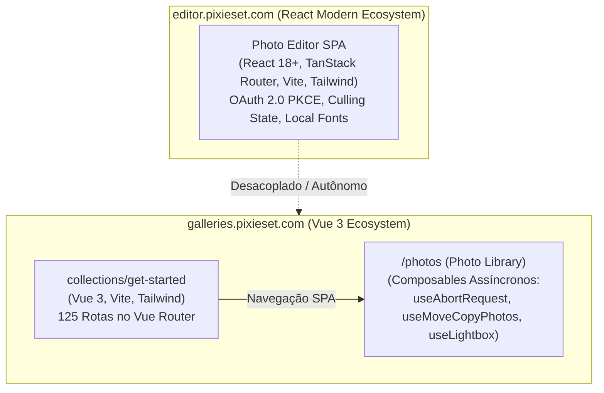
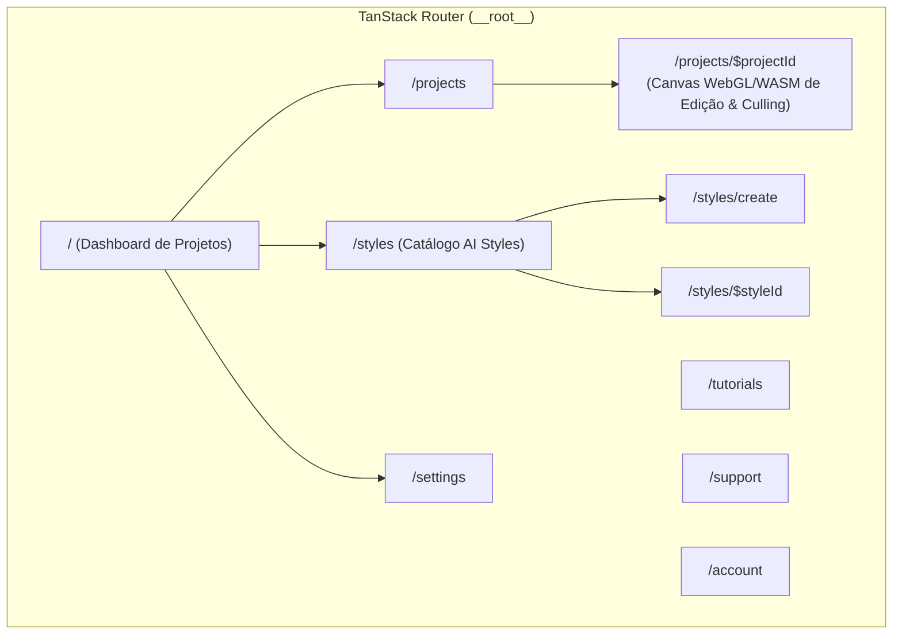

# Aprofundamento de Engenharia Reversa — 3 Alvos Pixieset

**Alvos Investigados**:
1. `https://galleries.pixieset.com/collections/get-started` (Onboarding e Criação de Coleções)
2. `https://galleries.pixieset.com/photos` (Biblioteca Central de Fotos e Busca Semântica)
3. `https://editor.pixieset.com/` (Pixieset Photo Editor & Estilos de IA)

**Metodologia**: Padrão `morluto/rea` com observação de runtime via Chrome DevTools Protocol (CDP), inspeção de React Fiber, Vue 3 Application Instance e árvores de acessibilidade.

---

## 1. Visão Geral e Comparativo Arquitetural dos 3 Alvos

A inspeção em tempo real revelou uma clara dicotomia de engenharia entre os subdomínios da Pixieset:



| Dimensão Técnica | `collections/get-started` | `/photos` (Biblioteca) | `editor.pixieset.com` |
| :--- | :--- | :--- | :--- |
| **Framework Base** | **Vue 3** (`data-v-app`, `@vueuse`) | **Vue 3** (`data-v-app`, `@vueuse`) | **React 18+** (`#root`, React Fiber) |
| **Roteador** | **Vue Router 4** (125 rotas mapeadas) | **Vue Router 4** (`photos-index`) | **TanStack Router** (`@tanstack/react-router`) |
| **Bundler** | **Vite** (`gd-assets.pixieset.com`) | **Vite** (`gd-assets.pixieset.com`) | **Vite** (`editor.pixieset.com/assets/`) |
| **Bundle JS Principal** | `main-CT59UP0y.js` (ES Module) | `main-CT59UP0y.js` (ES Module) | `main-DbcmmYAf.js` (ES Module) |
| **Chave de Estado / Store**| Vue Reactive State / VueUse | Vue Composables modulares | TanStack State + LocalStorage |
| **Autenticação** | Sessão via Cookie (`IDP_SID`) | Sessão via Cookie (`IDP_SID`) | **OAuth 2.0 PKCE** (`pixieset-token`) |
| **Telemetria Principal**| PostHog + Sentry + Intercom | PostHog + Sentry + Intercom | Amplitude (`AMP_*`) + Sentry Replay |

---

## 2. Alvo 1: `galleries.pixieset.com/collections/get-started`


### 2.1 Estrutura de Bundles e Dependências
* **Script de Entrada**: `https://gd-assets.pixieset.com/assets/web/main-CT59UP0y.js` (módulo ES).
* **Folhas de Estilo**:
  - `https://gd-assets.pixieset.com/assets/web/main-DoYG4gYE.min.css` (Tailwind CSS compilado e resets globais).
  - `https://gd-assets.pixieset.com/assets/web/get-started-ChMoxdDf.css` (módulo CSS isolado para onboarding).
* **Polyfills**: Injeção condicional via `cdnjs.cloudflare.com/polyfill/v3/polyfill.js` cobrindo `ResizeObserver`, `Intl.RelativeTimeFormat`, `Intl.DateTimeFormat`, `Array.prototype.at`, `Array.prototype.flatMap` e `Object.hasOwn`.
* **Telemetria e Feedback**: PostHog com módulo de pesquisas (`extendPostHogWithSurveys`), Meta Pixel (`fbevents.js`), Google Tag Manager (`GTM-MMHXLMX`) e Intercom (`widget/bvdpeh8u`).

### 2.2 Árvore do Vue Router (125 Rotas Mapeadas)
A instância ativa do Vue Router expõe um conjunto amplo de rotas corporativas protegidas por controle de acesso (`meta.featureAccess` e `meta.workspaceRole`):

```json
[
  { "name": "collections-get-started", "path": "/collections/get-started", "meta": { "activeNav": "collections-index" } },
  { "name": "collections-create", "path": "/collections/create", "meta": { "size": "large", "layout": "blank" } },
  { "name": "photos-insights", "path": "/photos/insights", "meta": { "featureAccess": "access_insights", "noBottomPadding": true } },
  { "name": "trash-collections", "path": "/trash/collections", "meta": { "featureAccess": "trash_collections_phase_1", "workspaceRole": "Owner,Admin,Member" } },
  { "name": "starred-photos", "path": "/starred/photos", "meta": { "checkpoint": "collection,folder" } },
  { "name": "starred-collections", "path": "/starred/collections", "meta": { "checkpoint": "collection,folder" } },
  { "name": "folders-create", "path": "/folders/create", "meta": { "checkpoint": "folder", "size": "large", "layout": "blank" } },
  { "name": "watermarks-create", "path": "/watermarks/create", "meta": { "layout": "blank" } },
  { "name": "text-templates-create", "path": "/text-templates/create", "meta": { "layout": "blank" } },
  { "name": "marketing.contacts", "path": "/marketing/contacts", "meta": { "noticeScope": "email_campaigns" } },
  { "name": "marketing.settings", "path": "/marketing/settings", "meta": { "noticeScope": "email_campaigns" } },
  { "name": "settings-presets", "path": "/settings/presets" },
  { "name": "settings-watermark", "path": "/settings/watermark" },
  { "name": "settings-integrations", "path": "/settings/integrations" },
  { "name": "settings-homepage", "path": "/settings/homepage" }
]
```

### 2.3 Componentes e Comportamento da UI
* **Barra Lateral (`<aside>` / `complementary`)**:
  - Botão de expansão/recolhimento da navegação (`button "Recolher barra lateral"` com estados `expandable` e `expanded`).
  - Navegação vertical com links ativos: *Coleções*, *Biblioteca*, *Estrelado*, *Lixo*, *Página inicial*, *Configurações*.
  - Medidor de Quota de Armazenamento: Link ativo `"0 GB de 3 GB usados"` com rota de upgrade dinâmica (`/account/selectplan/?product=client-gallery&source=storage-bar`).
* **Área Principal (`<main>`)**:
  - H1: `Coleções` com subtítulo `Comece agora`.
  - H1 de Destaque Onboarding: `Crie belas coleções de fotos em 3 passos`.
  - Botão CTA Primário: `Comece com fotos de exemplo.` (aciona injeção de acervo demonstrativo no workspace do fotógrafo).

---

## 3. Alvo 2: `galleries.pixieset.com/photos`


### 3.1 Rota e Chunks Assíncronos Exclusivos
* **Definição de Rota**:
  - `name`: `photos-index`
  - `path`: `/photos`
  - `meta`: `{ "isLayout": true, "featureAccess": "photo_library", "noBottomPadding": true }`
* **Módulos e Chunks CSS Carregados Dinamicamente**:
  1. `https://gd-assets.pixieset.com/assets/web/useAbortRequest-BdmxOJav.css`: Composable Vue para cancelamento imediato de requisições pendentes via `AbortController` ao digitar novas palavras-chave na busca.
  2. `https://gd-assets.pixieset.com/assets/web/useMoveCopyPhotos-CaZ8W8Oe.css`: Composable para orquestração de diálogos de movimentação e cópia de itens entre diferentes coleções/sets.
  3. `https://gd-assets.pixieset.com/assets/web/useLightbox-Ctx97Wk8.css`: Composable para inicialização do lightbox de inspeção rápida de metadados e imagem em alta resolução.
  4. `https://gd-assets.pixieset.com/assets/web/index-B7raF_X6.css`: Estilização da grade de busca da biblioteca.

### 3.2 Lógica do Front-end e Estados da Interface
* **Barra de Busca Semântica em Linguagem Natural**:
  - `<form class="group inline-flex size-full items-center py-2 pl-4">`
  - `<input type="text" placeholder="Pesquise 'noivos caminhando'" class="absolute top-0 size-full bg-transparent paragraph-1-400 text-font-gray-800 outline-hidden">`
  - Permite busca não apenas por nome de arquivo ou tag, mas por análise semântica de IA indexada no backend.
* **Estado Vazio (Empty State)**:
  - Condicional acionada quando `photosCount === 0`.
  - H2: `"Você ainda não tem fotos?"`
  - Descrição: `"Todas as fotos adicionadas às suas coleções aparecerão aqui. Comece criando uma coleção."`
  - Botão de Ação: `"Nova Coleção"` apontando diretamente para `https://galleries.pixieset.com/collections/create`.

---

## 4. Alvo 3: `editor.pixieset.com`


### 4.1 Arquitetura React e Roteamento com TanStack Router
Diferente dos outros subdomínios em Vue 3, o Pixieset Photo Editor é uma aplicação React de última geração construída com Vite e **TanStack Router**:



* **Estrutura de Rotas Confirmada no React Fiber**:
  - `__root__`
  - `/`
  - `/projects`
  - `/projects/$projectId` (workspace principal de culling e edição fotográfica)
  - `/styles`
  - `/styles/create`
  - `/styles/$styleId`
  - `/tutorials`
  - `/support`
  - `/settings`
  - `/account`
* **Persistência de Scroll**: Gerenciada pelo plugin nativo `tsr-scroll-restoration-v1_3` no `sessionStorage`.

### 4.2 Chunks e Módulos Identificados
* **Bundle JS**: `https://editor.pixieset.com/assets/main-DbcmmYAf.js` (Vite, type="module").
* **Chunks de Estilo**:
  - `https://editor.pixieset.com/assets/culling-state-DVR4eLsr.css` (estilos para o módulo de triagem e descarte de fotos com flags de cor/estrelas).
  - `https://editor.pixieset.com/assets/router-CUpRVOBa.css` (estilos e animações de transição de rota).
  - `https://editor.pixieset.com/assets/src-O90tGaEq.css` (componentes do workspace e painéis de ferramentas).

### 4.3 Sistema de Temas e Acesso a Recursos Nativos
O código de bootstrapping inline no `<head>` documenta explicitamente a sincronização com o código fonte:
```typescript
// Keep this bootstrap logic in sync with src/utils/theme-mode.ts.
// It must stay here so the correct theme is applied before the app bundle runs.
const DARK_CLASS_NAME = "dark";
const LIGHT_CLASS_NAME = "light";
const SETTINGS_STORAGE_KEY = "settings";
const SYSTEM_DARK_QUERY = "(prefers-color-scheme: dark)";
```
* **Fontes do Sistema**: Presença da chamada `window.queryLocalFonts()`, permitindo ao editor web acessar as fontes instaladas localmente no macOS/Windows para renderização de tipografia em marcas d'água e layouts.
* **Autenticação Baseada em Tokens (PKCE)**:
  - Ao invés de cookies HTTPOnly clássicos, o editor usa OAuth 2.0 com Proof Key for Code Exchange: chaves `pixieset-pkce`, `pixieset-pkce-session` e `pixieset-token` registradas no `localStorage`/`sessionStorage`.

### 4.4 Componentes da UI Mapeados
* **Barra Lateral de Ferramentas**:
  - Botão `open_projects` (Projetos)
  - Botão `open_ai_styles` (Estilos de IA)
  - Botão `open_tutorials` (Tutoriais)
  - Botão `open_settings` (Configurações)
  - Botão `open_desktop_app_download` (Download do aplicativo desktop nativo)
  - Botão `Account`
* **Área de Projetos**:
  - Botões de alternância de visualização: `Switch Projects To Grid View` vs. `Switch Projects To List View`.
  - Botões de criação: `Create New Project` e `Create New Project From Project Card`.
  - Card de Projeto Ativo: `Sample Project` (Data: `Oct 29, 2026`, Volume: `55 photos`), expondo `Project Options Sample Project` e botão acessível `Open Project Sample Project`.

---

## 5. Matriz Comparativa de Evidências

| Evidência Inspecionada | `collections/get-started` | `/photos` (Biblioteca) | `editor.pixieset.com` |
| :--- | :--- | :--- | :--- |
| **Ponto de Montagem** | `<div id="app" data-v-app>` | `<div id="app" data-v-app>` | `<div id="root">` |
| **Framework Detectado** | Vue 3.x (SSR Setters + VueUse) | Vue 3.x (SSR Setters + VueUse) | React 18+ (React Fiber Container) |
| **Roteamento** | Vue Router 4 (125 rotas) | Vue Router 4 (`photos-index`) | TanStack Router (`__root__` + 10 rotas) |
| **Auth Flow** | Cookie de Sessão IDP (`.pixieset.com`) | Cookie de Sessão IDP (`.pixieset.com`) | OAuth 2.0 PKCE (`pixieset-token`) |
| **CSS System** | Tailwind CSS (`main-DoYG4gYE`) | Tailwind CSS (`main-DoYG4gYE`) | Tailwind CSS (`src-O90tGaEq`) |
| **Suporte Offline / Fontes**| Não | Não | Sim (`queryLocalFonts`) |
| **Módulos Assíncronos** | `get-started-*.css` | `useAbortRequest`, `useMoveCopyPhotos`, `useLightbox` | `culling-state-*.css`, `router-*.css` |

---

## 6. Conclusões Técnicas

1. **Evolução Arquitetural Acelerada**: O ecossistema Pixieset é um exemplo vivo de coexistência arquitetural planejada:
   - O **Dashboard Central** (`accounts.pixieset.com`) permanece em **HTML5/Bootstrap/jQuery** por motivos de compatibilidade e tempo de resposta zero no login.
   - O **Client Gallery Admin** (`galleries.pixieset.com`) opera em **Vue 3 SPA com Vite**, estruturado para gerenciar milhares de fotos com composables assíncronos (`useAbortRequest`, `useMoveCopyPhotos`).
   - O **Photo Editor** (`editor.pixieset.com`) representa a vanguarda técnica da empresa: construído em **React 18+, TanStack Router e OAuth PKCE**, com suporte a fontes nativas do sistema operacional e manipulação pesada de estado client-side (culling).
2. **Alta Fidelidade de Reconstrução**: O isolamento dos composables (`useLightbox`, `useMoveCopyPhotos`, `useAbortRequest`) e da árvore de rotas do TanStack Router fornece a planta exata necessária para implementar qualquer um desses módulos com paridade comportamental 1.0.
