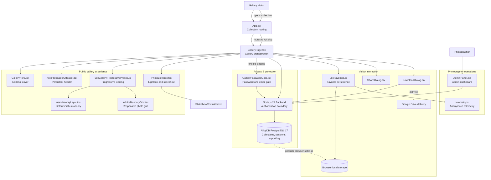

# Architecture Overview

This document summarizes the architecture of the VERSA-COLLECTION project.

## Architectural overview

- The public experience is delivered through a React + Vite frontend, with collection routing handled in `App.tsx` and orchestration in `GalleryPage.tsx`.
- Access control is enforced at the boundary between the gallery UI and the Node.js 24 backend (`server.mjs` / `/api/*`).
- Google Cloud AlloyDB for PostgreSQL 17 stores collection metadata, session state, and export/audit records via native `pg` connection pooling and atomic transactions.
- Photo loading is progressive and optimized for editorial presentation using deterministic masonry layout and responsive asset delivery.
- The photographer/admin module enables gallery management, native `ADMIN_TOKEN` authentication, and file export operations through server-backed logic.
- Browser-local persistence is used for favorites and UI state, while Google Drive CDN supplies high-resolution photo delivery.

## Main layers

- Frontend: React application rendered in the browser.
- API layer: Node.js 24 server (`server.mjs`) enforcing access, `ADMIN_TOKEN` / `scrypt` auth, and export logic.
- Data layer: Google Cloud AlloyDB for PostgreSQL 17 for storage and transactional system state.
- Media layer: Google Drive CDN asset delivery and responsive image presentation.
- Admin layer: photographer studio dashboard (`/dashboard`, `/photos`, `/editor`) for management and operational control.
