# Relatório Técnico de Engenharia Reversa — Dashboard Pixieset

**Alvo Primário**: `https://accounts.pixieset.com/dashboard/`  
**Metodologia**: Padrão de Engenharia Reversa e Inspeção de Runtime (`morluto/rea`)  
**Data da Auditoria**: Outubro de 2026  
**Ambiente de Inspeção**: Chrome DevTools Protocol (CDP através de REA) no endpoint `http://[::1]:9222`, Target ID `BE83DCE0599D992A14AD15DD928FE3BF`  
**Sessão / Perfil**: Sessão autenticada ativa do usuário `Vinicius Cunha Fotografia`

---

## 1. Resumo Executivo

O presente documento consolida a investigação arquitetural e desmontagem de front-end do painel central da plataforma Pixieset (`accounts.pixieset.com/dashboard/`), conduzida em conformidade com o framework conceitual de evidências e rastreabilidade do projeto `morluto/rea`.

### Principais Constatações Técnicas:
1. **Topologia Multi-Page Application (MPA) / Portal de Identidade Federado**: O dashboard central não opera como uma Single-Page Application (SPA) monolítica. Ele atua como um hub centralizado de autenticação (SSO / IDP) e orquestração de produtos. Cada serviço listado (Client Gallery, Website, Store, Studio Manager, Mobile Gallery App, Photo Editor) reside em subdomínios autônomos (`*.pixieset.com`) com ciclos de vida e stacks próprios.
2. **Pilha Tecnológica do Dashboard**:
   - **Renderização Base**: Server-Side Rendering (SSR) via template PHP/HTML5, hidratado com os dados da conta no momento da resposta HTTP.
   - **Camada de Estilo e Design System**: Combinação híbrida entre Twitter Bootstrap (componentes de navegação e dropdowns), classes de utilitários atômicos proprietários da Pixieset (estilo Tachyons/Tailwind primitivo: `f-14`, `c-000`, `fw6`, `spacer-inner-*`) e componentes com metodologia BEM (`ps-btn ps-btn--primary ps-btn--md`).
   - **Bibliotecas de Script**: jQuery 1.9.1, Bootstrap JS plugins (`dropdown`, `toggle`), Adobe Typekit para fontes editoriais, Intercom Messenger para suporte ao vivo e Atlassian Statuspage para alertas de disponibilidade da infraestrutura.
3. **Proteção de Borda e Acesso**: O endpoint de dashboard é estritamente privado, protegido por redirecionamento HTTP `302` para `https://accounts.pixieset.com/login/` na ausência dos cookies de sessão `IDP_SID` e `__cf_bm`. A borda conta com desafios gerenciados Cloudflare Turnstile / Bot Management.

---

## 2. Topologia de Runtime e Arquitetura Federada

A infraestrutura client-side da Pixieset divide responsabilidades entre múltiplos subdomínios conectados por autenticação unificada de cookies de domínio (`domain=.pixieset.com`):

```mermaid
graph TD
    subgraph Edge ["Borda & Autenticação"]
        CF["Cloudflare Edge<br/>(Turnstile & Bot Management)"]
        AuthCookie["Cookies Globais de Sessão<br/>IDP_SID | __cf_bm"]
    end

    subgraph DashboardHub ["accounts.pixieset.com (MPA / Hub Central)"]
        Dashboard["Dashboard Central<br/>/dashboard/ (HTML5, Bootstrap, jQuery)"]
        StatuspageFrame["Iframe Atlassian Statuspage<br/>p45y6wxnvdys.statuspage.io"]
        IntercomWidget["Intercom Messenger Widget<br/>js-intercom-contact"]
    end

    subgraph Products ["Produtos Federados (Subdomínios Autônomos)"]
        Gallery["Client Gallery<br/>gallery.pixieset.com & galleries.pixieset.com<br/>(Vue 3, Pinia, Tailwind)"]
        Studio["Studio Manager<br/>studio.pixieset.com<br/>(React SPA)"]
        Web["Website Builder<br/>website.pixieset.com"]
        Store["Store / E-commerce<br/>gallery.pixieset.com/store/"]
        MobileApp["Mobile Gallery App<br/>mobileapp.pixieset.com"]
        Editor["Photo Editor<br/>editor.pixieset.com"]
        Blog["Blog Institucional<br/>blog.pixieset.com (WordPress)"]
    end

    CF --> Dashboard
    AuthCookie -.-> Dashboard
    AuthCookie -.-> Products
    Dashboard -->|Iframe Embed| StatuspageFrame
    Dashboard -->|Client SDK| IntercomWidget
    Dashboard -->|Navegação Cross-Domain| Gallery
    Dashboard -->|Navegação Cross-Domain| Studio
    Dashboard -->|Navegação Cross-Domain| Web
    Dashboard -->|Navegação Cross-Domain| Store
    Dashboard -->|Navegação Cross-Domain| MobileApp
    Dashboard -->|Navegação Cross-Domain| Editor
    Dashboard -->|Link Externo| Blog
```

---

## 3. Mapas de Scripts e Estrutura de Bundles

### 3.1 Arquivos Carregados na Inicialização (Tags `<HEAD>` e `<BODY>`)

A inspeção do grafo de nós DOM (`dom.nodes` com 1.123 itens totais) identificou os seguintes recursos e scripts injetados no documento:

| Elemento / Nó | Tipo | Atributos Observados | Função Arquitetural |
| :--- | :--- | :--- | :--- |
| **Nó 10** | `<script>` | `type="text/javascript" async src="..."` | Rastreamento e telemetria de borda |
| **Nó 11-17** | `<script>` | `async src="..."` | Bibliotecas assíncronas de terceiros (Analytics, Tag Manager) |
| **Nó 18** | `<script>` | `inline` | Definição de objetos de escopo global `window.Pixieset` |
| **Nó 29, 31, 33**| `<link>` | `rel="stylesheet" type="text/css"` | CSS base do Bootstrap e folhas de estilo do Design System Pixieset |
| **Nó 35, 37, 39**| `<script>` | `type="text/javascript" src="..."` | Bibliotecas fundacionais: jQuery 1.9.1, Modernizr 2.8.3, Bootstrap Core |
| **Nó 41, 43, 45**| `<script>` | `type="text/javascript" src="..."` | Módulos utilitários (`JsTranslations/JsTrans.min.js`, Typekit) |
| **Nó 47, 49** | `<style>` | `type="text/css"` | Estilos críticos inline e resets de tipografia |
| **Nó 51** | `<script>` | `inline` | Configuração de internacionalização e locale (`pt-BR`) |
| **Nó 57** | `<script>` | `async src="challenges.cloudflare.com..."` | Desafio de segurança Cloudflare Turnstile |
| **Nó 1078-1081**| `<script>` | `type="module" crossorigin src="..."` | Módulos ES de suporte e inicializadores modernos |
| **Nó 1082, 1085**| `<script>` | `inline` | Inicialização dos componentes de tela e contadores |
| **Nó 1091** | `<script>` | `src="..."` | SDK do Intercom Messenger |
| **Nó 1106** | `<script>` | `type="application/json" id="..."` | Payload serializado de dados da sessão e perfil |

### 3.2 Scripts Inline Mapeados em Runtime

A inspeção de runtime via CDP registrou 11 scripts inline nativos no contexto de execução do target `BE83DCE0599D992A14AD15DD928FE3BF`:

| Identificador do Script (REA Key) | Tamanho | Hash CDP (SHA-256) | Finalidade Identificada |
| :--- | :--- | :--- | :--- |
| `scr_4d8f51ef...` | 1.886 B | `02429d5cd21f0919...` | Inicialização do estado de usuário e flags de produto |
| `scr_81a8459e...` | 2.441 B | `07a3a50936e9714d...` | Manipulação de eventos dos dropdowns da barra superior |
| `scr_874c1ad2...` | 842 B | `3006022c311d7996...` | Setup do launcher do Intercom (`.js-intercom-contact`) |
| `scr_87f96d42...` | 413 B | `0cc612be40cb36cd...` | Listener de métricas e analytics de cliques no dashboard |
| `scr_91339bec...` | 412 B | `74392fb5a1a69c31...` | Interpolação de links de indicação (`referral-link`) |
| `scr_9690c2ca...` | 630 B | `321aba4c20dd675b...` | Monitoramento de notificações do usuário |
| `scr_b553493a...` | 543 B | `494d34a65e8cff7a...` | Listener de iframe de status da Atlassian |
| `scr_b9d5b96a...` | 571 B | `42169700284b13e4...` | Gestão de expiração de token de sessão |
| `scr_ce3a38e3...` | 693 B | `f5e79e95c8268e5a...` | Registro de telemetria operacional |
| `scr_e08150d4...` | 54 B | `14ebedc8d199a921...` | Script inline de bootstrap de tags |
| `scr_f73f6677...` | 675 B | `402a82fd7a13aca6...` | Lógica de renderização de cards de coleção recente |

---

## 4. Inventário Detalhado de Widgets e Componentes

A inspeção cruzada entre árvore de acessibilidade (423 nós), modelo de caixa do DOM e leitura visual via Vision OCR permitiu mapear cada componente visível da interface:

```mermaid
graph TD
    subgraph UI ["Árvore Estrutural da Interface"]
        TopNav["1. Barra de Navegação Superior (Header)"]
        Welcome["2. Header Editorial de Boas-Vindas"]
        ProductsGrid["3. Grade de Produtos (6 Cards Especializados)"]
        QuickAccess["4. Seção de Acesso Rápido (2 Colunas)"]
        MoreSection["5. Seção 'Mais do Pixieset' (Feed Editorial & Banners)"]
        IntercomBtn["6. Widget Flutuante de Suporte (Intercom)"]
    end

    TopNav --> Logo["PIXIESET (.navbar-brand)"]
    TopNav --> Dropdown["Dropdown 'Painel' (.top-nav-link.dropdown-toggle)"]
    TopNav --> Notif["Notificações (.mobile-nav-notification)"]
    TopNav --> Avatar["Menu do Fotógrafo (.profile-icon)"]

    ProductsGrid --> P1["Client Gallery"]
    ProductsGrid --> P2["Website"]
    ProductsGrid --> P3["Store"]
    ProductsGrid --> P4["Studio Manager"]
    ProductsGrid --> P5["Mobile Gallery App"]
    ProductsGrid --> P6["Photo Editor"]

    QuickAccess --> RecentCol["Coleções Recentes (Card Ativo)"]
    QuickAccess --> RecentOrders["Pedidos Recentes (Empty State)"]
    QuickAccess --> QuickLinks["Links Rápidos (Perfil, Conta, Cobrança, Indique)"]
```

### 4.1 Barra Superior (`<nav class="navbar" role="navigation">`)
* **Logo Institucional**: Tag `<a>` com classe `.navbar-brand` apontando para `https://accounts.pixieset.com/dashboard/`.
* **Dropdown de Produtos ("Painel")**: Elemento `<a>` com classes `.top-nav-link.dropdown-toggle`, acionando dropdown com lista de produtos e descritivos em duas linhas (`hover-bg-transparent`).
* **Botão Fale Conosco**: Classe `.js-intercom-contact` abrindo diretamente o messenger flutuante.
* **Ícone de Notificações**: Elemento com classe `.top-nav-link.mobile-nav-notification`, exibindo contador "0" e link para `https://gallery.pixieset.com/notification/`.
* **Avatar de Usuário ("V")**: Botão circular com classe `.top-nav-link.dropdown-toggle.profile-icon`, exibindo a inicial do fotógrafo e acionando menu com:
  - *Convide amigos e ganhe $20* (`.referral-link`)
  - *Perfil* (`/account/profile/`)
  - *Cobrança* (`/account/billing/`)
  - *Configurações avançadas* (`/account/advanced/`)
  - *Conta* (`/account/`)
  - *Sair* (`/logout/`)

### 4.2 Cabeçalho de Boas-Vindas
* **Título H1**: Nó de acessibilidade `#622`: `"Bem-vindo, Vinicius Cunha Fotografia"`.
* **Tipografia**: Outfit / Sans-serif corporativa, com espaçamento vertical `.spacer-inner-top-15.spacer-inner-bottom-15`.

### 4.3 Grade de Produtos (H2 "PRODUTOS")
Contêiner com 6 cartões dispostos em grid responsivo (`display-n display-b-md` no mobile, 6 colunas no desktop):

1. **Client Gallery**:
   - Cabeçalho: `.f-18.fw6.nowrap.c-000` -> `https://gallery.pixieset.com/collection/`
   - Ações Rápidas:
     - *Gerenciar coleções* (`https://gallery.pixieset.com/collection`)
     - *Criar coleção* (`https://gallery.pixieset.com/collection/?create`)
     - *Pesquisar biblioteca de fotos* (`https://galleries.pixieset.com/photos`)
     - *Ver página inicial* (`https://gallery.pixieset.com/client/gotohome/`)
     - *Configurações* (`https://gallery.pixieset.com/collection/settings/`)
2. **Website**:
   - Cabeçalho: `https://website.pixieset.com/`
   - Ação Rápida: *Editar site* (`https://website.pixieset.com/`)
3. **Store**:
   - Cabeçalho: `https://gallery.pixieset.com/store/`
   - Ações Rápidas:
     - *Ver pedidos* (`https://gallery.pixieset.com/store/orders/`)
     - *Configurações* (`https://gallery.pixieset.com/store/settings/`)
4. **Studio Manager**:
   - Cabeçalho: `https://studio.pixieset.com/`
   - Ações Rápidas:
     - *Gerenciar contatos* (`https://studio.pixieset.com/contacts`)
     - *Novo projeto* (`https://studio.pixieset.com/projects/create`)
     - *Novo documento* (`https://studio.pixieset.com/create-document`)
     - *Nova sessão* (`https://studio.pixieset.com/sessions/create`)
     - *Nova mensagem* (`https://studio.pixieset.com/inbox?compose=1`)
     - *Ver pagamentos* (`https://studio.pixieset.com/payments`)
5. **Mobile Gallery App**:
   - Cabeçalho: `https://mobileapp.pixieset.com/`
   - Ações Rápidas:
     - *Gerenciar apps* (`https://mobileapp.pixieset.com/`)
     - *Criar novo app* (`https://mobileapp.pixieset.com/?create`)
     - *Configurações* (`https://mobileapp.pixieset.com/user/profile/`)
6. **Photo Editor**:
   - Cabeçalho: `https://editor.pixieset.com/`
   - Ações Rápidas:
     - *Ver projetos* (`https://editor.pixieset.com/projects`)
     - *Ver estilos de IA* (`https://editor.pixieset.com/styles`)

### 4.4 Painel de Acesso Rápido (H2 "ACESSO RÁPIDO")
Divisão em 2 colunas principais:
* **Coluna de Atividades do Fotógrafo**:
  - **Coleções Recentes**:
    - Nome da Coleção: `DEMO — ENGENHARIA REVERSA`
    - Destino: `https://gallery.pixieset.com/collection/125725855/`
    - Badge de Status: `Publicada`
    - Data: `28 de outubro de 2026`
    - Régua de Métricas (Ícones FontAwesome + Contadores):
      - `` Fotos: **42**
      - `` Downloads: **0**
      - `` Favoritos: **0**
      - `` E-mails registrados: **0**
  - **Pedidos Recentes (Estado Vazio)**:
    - Título: `Configure sua loja de impressões ininterruptas` (H4)
    - Subtítulo: `Lance sua loja online em 4 etapas fáceis`
    - CTA: Botão `Começar` com classes `.ps-btn.ps-btn--primary.ps-btn--md` direcionando para `https://gallery.pixieset.com/store/`.
  - **Notificações Recentes (Estado Vazio)**:
    - Título: `Suas notificações mais recentes` (H4)
    - Descrição: `Toda a atividade mais recente dos seus clientes será exibida aqui`.
* **Coluna de Links Rápidos (`LINKS RÁPIDOS`)**:
  - *Seu perfil*: Edite sua foto de perfil, nome comercial e muito mais (`/account/profile/`)
  - *Conta*: Edite seu nome de usuário, e-mail e senha (`/account/`)
  - *Cobrança*: Gerencie suas assinaturas atuais e veja o histórico de cobrança (`/account/billing/`)
  - *Indique um amigo*: Ganhe créditos de indicação por cada amigo que você indicar (`/referral/?source=dashboard-quick-links`)

### 4.5 Seção "Mais do Pixieset" (H2)
* **Banner de Central de Ajuda**: Título H4 `Estamos aqui para ajudar` -> `https://help.pixieset.com/`.
* **Banner de Recompensa de Indicação**: Título H4 `Convide amigos e ganhe $20` -> `https://gallery.pixieset.com/referral/?source=dashboard-more-from-pixieset`.
* **Widget do Blog Corporativo**:
  - Título da Seção: `BLOG DO PIXIESET` (link para `https://blog.pixieset.com/`)
  - Postagem em Destaque: `⚡️ New features to grow your marketing list in Pixieset` (Data: Oct 6th, 2026)
  - Resumo editorial: Mecanismo de opt-in para captação de e-mails em websites e galerias.
  - Link com tracking UTM: `?utm_source=featured+dashboard&utm_medium=post&utm_campaign=grow+marketing+list`.

---

## 5. Fluxo de Navegação e Transições da Interface

### 5.1 Roteamento e Transições
Por se tratar de uma arquitetura federada baseada em MPA:
1. **Transições Intra-Dashboard**:
   - Cliques nos dropdowns (`#Painel`, `#Perfil`) alternam classes CSS (`.dropdown.open`) controladas pelo plugin de dropdown do Bootstrap sem alterar a URL.
   - O clique no ícone do Intercom dispara o carregamento e exibição da janela flutuante via chamada JavaScript nativa da API Intercom (`Intercom('show')`).
2. **Navegação Cross-Subdomain**:
   - Todos os links para produtos (Client Gallery, Studio Manager, Store) utilizam transições de navegação completas pelo navegador (`window.location`), transferindo o usuário do subdomínio `accounts.pixieset.com` para os serviços correspondentes.
   - A continuidade de contexto (sessão autenticada) é garantida pelo compartilhamento de cookies em nível de domínio pai (`.pixieset.com`).

### 5.2 Matriz de Rotas do Dashboard

| Rota / Destino | Subdomínio | Tipo de Acesso | Tipo de Transição |
| :--- | :--- | :--- | :--- |
| `/dashboard/` | `accounts` | Privado (Exige `IDP_SID`) | MPA (Página Inicial) |
| `/collection/` | `gallery` | Privado (Sessão compartilhada) | HTTP GET Cross-Domain |
| `/collection/125725855/` | `gallery` / `galleries` | Privado (Painel da coleção) | HTTP GET Cross-Domain |
| `/store/` | `gallery` | Privado | HTTP GET Cross-Domain |
| `/` | `studio` | Privado | HTTP GET Cross-Domain (SPA) |
| `/` | `website` | Privado | HTTP GET Cross-Domain |
| `/projects` | `editor` | Privado | HTTP GET Cross-Domain |
| `/account/profile/` | `gallery` | Privado | HTTP GET Cross-Domain |
| `/account/billing/` | `gallery` | Privado | HTTP GET Cross-Domain |
| `/help.pixieset.com/` | `help` | Público / Suporte | Link Externo |
| `/blog/` | `blog` | Público / Editorial | Link Externo |

---

## 6. Estados de Interface e Condicionais

### 6.1 Mapeamento de Estados da UI

| Componente | Estado Observado | Mecanismo de Implementação | Efeito Visual |
| :--- | :--- | :--- | :--- |
| **Dropdown Superior** | `collapsed` (Padrão) | Classe `.dropdown` sem `.open` | Menu recolhido fora da viewport |
| **Dropdown Superior** | `expanded` (Ao clicar) | Adição dinâmica da classe `.open` | Exibição de container suspenso com sombra |
| **Coleção Recente** | `active / published` | Classe de status `.badge-published` | Tag verde/sólida `"Publicada"` |
| **Pedidos Recentes** | `empty state` | Ausência de tabela de pedidos no DOM; injeção de bloco informativo | Card explicativo com botão CTA `"Começar"` |
| **Notificações** | `empty state` | Contador com texto `"0"` e mensagem explicativa | Sem badge vermelho de alerta pendente |
| **Responsividade** | `hidden-xs / display-b-md` | Media queries CSS do Bootstrap (`@media min-width`) | Oculta colunas em mobile e expande em desktop |
| **Intercom** | `collapsed` | Propriedades ARIA: `expanded: false`, `live: polite` | Botão circular flutuante no canto inferior direito |

### 6.2 Lógica Condicional de Exibição
1. **Dados de Coleções Recentes**:
   - Renderização controlada pelo servidor: quando o fotógrafo possui coleções ativas, o contêiner injeta o bloco com nome, data e contadores métricos (42 fotos, 0 downloads). Na ausência de coleções, o template renderiza estado vazio análogo ao de pedidos.
2. **Dados de Pedidos da Loja**:
   - Como o fotógrafo auditado ainda não concluiu a configuração de métodos de pagamento e catálogo, o backend emite o bloco instrucional *"Configure sua loja de impressões ininterruptas"*.
3. **Mecanismo de Ocultação**:
   - Diferente de SPAs reativas que utilizam desmontagem do Virtual DOM (`v-if` no Vue ou conditional rendering no React), o dashboard Pixieset utiliza SSR estrito: estados não aplicáveis sequer são incluídos no HTML retornado pelo servidor, economizando nós no DOM e eliminando riscos de vazamento de dados não autorizados no cliente.

---

## 7. Estrutura da Lógica do Dashboard

### 7.1 Pontos de Entrada e Bootstrapping
1. **Requisição Inicial**: O navegador solicita `GET /dashboard/` com credenciais HTTP.
2. **Checagem de Sessão na Borda**: Cloudflare valida os cookies `__cf_bm` e `IDP_SID`. Caso inválidos ou ausentes, responde com `HTTP 302 Location: /login/`.
3. **Hidratação do HTML no Servidor**: O backend resolve os dados do fotógrafo logado (`Vinicius Cunha Fotografia`), o resumo da coleção ativa (ID `125725855`) e compila o HTML com as classes de estilização.
4. **Execução de Scripts Client-Side**:
   - `jQuery` e `Bootstrap` inicializam listeners para modais, tooltips e dropdowns.
   - Script assíncrono carrega o SDK do Intercom, configurando o contexto com o ID do usuário.
   - Iframe embutido conecta a `https://p45y6wxnvdys.statuspage.io/embed/frame` para escuta de incidentes ou instabilidades ativas nos serviços.

### 7.2 Chamadas de API e Dependências de Terceiros
* **Atlassian Statuspage**:
  - Endpoint do Iframe: `https://p45y6wxnvdys.statuspage.io/embed/frame`
  - Target ID associado no Chrome: `1D419D8386ED47E140D690F7F7658B0C`
  - Função: Exibição não intrusiva de faixas de aviso caso algum microsserviço Pixieset esteja degradado.
* **Intercom Messenger**:
  - Acionamento: Seletor `.js-intercom-contact`
  - Nó de Acessibilidade: Botão com label `"Open Intercom Messenger"`
  - Função: Atendimento ao cliente e suporte técnico direto.
* **Adobe Typekit**:
  - Endpoint: `https://use.typekit.net/ewz7nsv.js`
  - Função: Carregamento de fontes tipográficas editoriais.

---

## 8. Conclusões e Observações Técnicas

### 8.1 Síntese Arquitetural
* O painel `accounts.pixieset.com/dashboard/` é arquitetado com foco em **baixa complexidade de execução client-side e velocidade de carregamento**. Por não ser uma SPA pesada, o tempo de inicialização (First Meaningful Paint) é extremamente reduzido.
* A separação entre o Dashboard de Contas (Bootstrap/jQuery) e as ferramentas mais complexas (como o Gestor de Coleções em Vue 3 ou o Studio Manager em React) demonstra uma migração gradual de microsserviços frontend ("Strangler Fig Pattern"), onde o portal antigo continua operando como hub de login enquanto os produtos são modernizados de forma desacoplada.

### 8.2 Matriz de Rastreabilidade e Nível de Certeza (Padrão REA)

| Elemento / Afirmação | Nível de Certeza | Fonte da Evidência | Observações Técnicas |
| :--- | :--- | :--- | :--- |
| **Arquitetura MPA / Federated Hub** | **Confirmado** | Inspecionado no Navegador / CDP | Links apontam para subdomínios distintos com recarga de página completa |
| **Uso de jQuery 1.9.1 e Bootstrap** | **Confirmado** | Inspecionado no Código / DOM | Scripts declarados nas tags `<head>` e classes `.navbar-brand`, `.dropdown-toggle` |
| **Nome da Coleção Recente e Contadores** | **Confirmado** | Inspecionado no DOM e OCR Visual | DEMO — ENGENHARIA REVERSA com 42 fotos e 0 downloads |
| **Proteção por Cloudflare e Cookie IDP_SID** | **Confirmado** | Headers HTTP / Curl | Resposta HTTP `302` imediata na ausência de cookie |
| **Migração Gradual para Vue 3 no Painel de Fotos** | **Confirmado** | Target CDP `8724F81B...` | `galleries.pixieset.com` carrega Vue 3 e Pinia |
| **Uso de WebSockets no Dashboard** | **Não Observado** | Tráfego de Rede CDP | O dashboard utiliza apenas HTTP convencional e iframe do Statuspage |

---

## 9. Bibliografia de Evidência

### URLs Canônicas Auditadas:
- Dashboard: `https://accounts.pixieset.com/dashboard/`
- Login / IDP: `https://accounts.pixieset.com/login/`
- Coleção Recente Auditada: `https://gallery.pixieset.com/collection/125725855/`
- Painel Administrativo Vue 3: `https://galleries.pixieset.com/collections/125725855/sets/181343331`
- Galeria Pública Vinculada: `https://viniciuscunhafotografia84.pixieset.com/demoengenhariareversa/`
- Statuspage Frame: `https://p45y6wxnvdys.statuspage.io/embed/frame`

### Classes e Seletores DOM Chave:
- `.navbar-brand`, `.top-nav-link.dropdown-toggle`, `.profile-icon`
- `.mobile-nav-notification`, `.referral-link`, `.js-intercom-contact`
- `.ps-btn.ps-btn--primary.ps-btn--md`
- `.c-000`, `.c-777`, `.hover-c-333`, `.hover-c-555`, `.hover-o-90`
- `.spacer-inner-top-15`, `.spacer-inner-bottom-15`, `.spacer-inner-bottom-7`
- `.display-n`, `.display-b-md`

### Identificadores REA e Evidências Salvas:
- Target ID Primário: `BE83DCE0599D992A14AD15DD928FE3BF`
- Frame Filho (Statuspage): `1D419D8386ED47E140D690F7F7658B0C`
- Captura de Tela do Dashboard: `pixieset_dashboard.png` (2400x1710, Display P3)
- Evidência Primária REA: `ev_a4f28a93c9ef9f13eef115c18d39e21b4fc21cd52ceb0cf7e20b0658b4002bdb`
